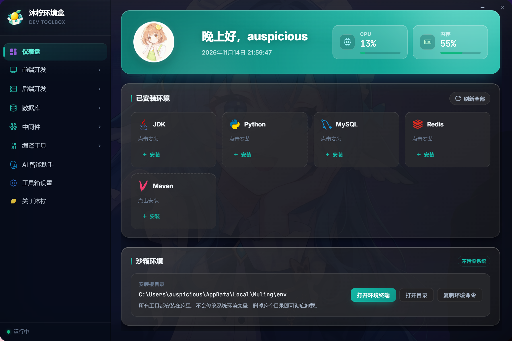
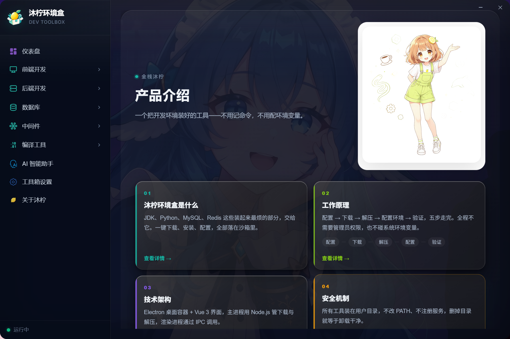
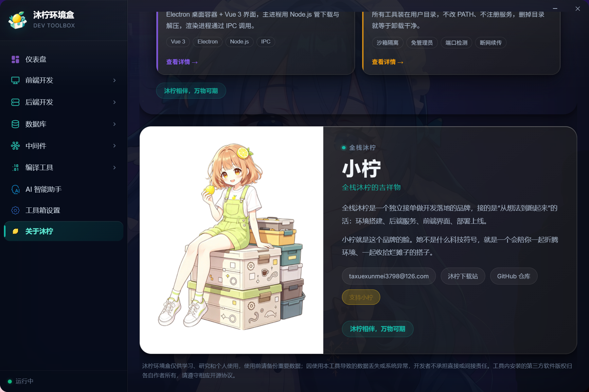

<div align="center">


# 沐柠环境盒 · Muling Environment Box

**把 JDK、Python、MySQL、Redis 这些装起来最烦的东西，变成点两下的事。**

<a href="https://www.muling-download.site"></a>


一个 Windows 桌面工具：**沙箱式**安装与切换开发环境，不写系统环境变量、不需要管理员权限，删掉目录就等于卸载干净。

[下载](#下载) · [主要特性](#主要特性) · [支持的工具](#支持的工具) · [打包成 exe](#打包成-exe) · [常见问题](#常见问题)

</div>

---

## 截图

<table>
<tr>
<td width="50%"><br><sub><b>仪表盘</b> · 已装环境、CPU/内存、沙箱入口</sub></td>
<td width="50%"><br><sub><b>产品介绍</b> · 四块磁贴，点开看详情</sub></td>
</tr>
</table>


<sub><b>关于页</b> · 小柠是全栈沐柠的吉祥物</sub>

---

## 它解决什么问题

装一个 Java 环境，你可能要做这些事：

1. 去 Oracle 官网找版本、等下载、点安装向导
2. 手动加 `JAVA_HOME`，再把它拼进 `PATH`
3. 想换版本时，改 `JAVA_HOME`、改 `PATH`、重开所有终端
4. 装 MySQL 时被注册成 Windows 服务，卸载后服务还在
5. 哪天想彻底清理，发现根本不知道它往系统里写了什么

**沐柠环境盒把这 5 步压成 2 步**：选版本 → 点安装。

所有东西都装在 `%LOCALAPPDATA%\Muling\env` 下面，系统环境变量一个字节都不动（除非你主动开「注入系统变量」）。

---

## 主要特性

### 🧊 沙箱：装在天上，不在系统里

| | 传统安装 | 沐柠环境盒 |
|---|---|---|
| 安装位置 | `C:\Program Files\...` 或任意 | `%LOCALAPPDATA%\Muling\env\<工具>\<版本>` |
| 系统变量 | 改 HKLM 的 `PATH`、`JAVA_HOME` 等 | 默认不动，只写沙箱内的配置 |
| 管理员权限 | 通常需要 | **不需要** |
| 多版本共存 | 手动改变量来回切 | 点一下卡片就切换，互不干扰 |
| 卸载 | 找卸载程序，可能残留 | 删掉那个目录 |
| 回滚 | 重装 | 切回旧版本，还在 |

需要命令行直接用 `java`？打开 **沐柠环境终端**（会自动配好 PATH），或者在界面里对单个工具打开「注入系统变量」——随时可以「一键撤出」。

### 🖥️ 内置终端

底部抽屉式终端，基于 xterm + node-pty，直接继承当前沙箱环境的 PATH。装完就能 `java -version`、`python -V`、`npm -v`，不用改任何系统设置。

### 🔀 多版本并存与切换

JDK 从 8 到 26、Python 从 3.9 到 3.13、MySQL 8.0/8.4/9.3……同一个工具的不同版本可以同时装着，点卡片设默认，切完即生效。

### 🩺 一键体检

检查每个已装环境的核心文件是否还在（被误删、被杀软清掉、解压中断都能查出来），坏掉的直接给「重新安装」入口。

### 💾 配置备份与迁移

把「装了哪些版本、默认是哪个、Nginx 站点配置」打包成 `.mlenv` 文件，换电脑时一键还原。可选连程序文件一起打包（几百 MB 到几 GB）。

### 🧩 老环境接管

已经在 `C:\Program Files` 装过 JDK/Python/MySQL 的，不用重装——检测到后点「接管」，只登记路径，**不移动、不复制**你的文件。

### 🔌 端口自动避让

3306 被占用？安装或启动 MySQL 时自动往后找可用端口并回写配置，不用自己改 `my.ini`。

### 🧹 其他

- 断点续传 + 断网重试 + 备用源
- 安装进度按「下载 / 解压 / 配置」分阶段显示，失败的那一步标红
- 服务（MySQL / Redis / Nginx）日志直接在界面里看
- 关窗默认最小化到托盘，服务继续跑
- 开机自启（可选，进托盘不打扰）

---

## 支持的工具

共 **9 个工具、75 个版本**：

| 工具 | 版本 | 说明 |
|---|---|---|
| **JDK** | 18 个（8 → 26） | Temurin / Zulu 等发行版打包 |
| **Python** | 10 个（3.9 → 3.13） | 已处理 `import site`，pip 可用 |
| **MySQL** | 3 个（8.0 / 8.4 / 9.3） | 进程方式启动，不注册 Windows 服务 |
| **Redis** | 12 个 | 进程方式，pid 文件管理 |
| **Maven** | 5 个 | 自动写阿里云镜像 |
| **Gradle** | 10 个 | 自动写阿里云镜像 |
| **Nginx** | 7 个 | 支持站点管理、配置编辑 |
| **uv** | 5 个 | 单文件工具，Python 包管理 |
| **Node.js** | 5 个（18 / 20 / 22 / 24 / 26） | 自带 `etc/npmrc`，指向 npmmirror |

---

## 下载

- 官网：<https://www.muling-download.site>
- 安装包：`MulingEnvBox-Setup-2.1.0.exe`（NSIS，支持自定义安装目录）

系统要求：**Windows 10 / 11（64 位）**，约 300MB 磁盘空间（不含工具）。

---

## 从源码运行

```bash
# 1. 装依赖（Node.js 20.19+ 或 22.12+）
npm install

# 2. 开发模式（同时起 Vite 和 Electron）
npm run electron:dev

# 3. 只要界面（浏览器里调试）
npm run dev
```

> 单独 `electron .` 只会得到一个空窗口——界面由 Vite 提供。Windows 上如果设置了 `ELECTRON_RUN_AS_NODE=1`，请先 `Remove-Item Env:ELECTRON_RUN_AS_NODE`。

---

## 打包成 exe

```bash
npm run electron:build
```

这条命令做两件事：`vite build` 生成 `dist/`，然后 `electron-builder` 打 NSIS 安装包。

产物在 `dist_electron/`：

```
dist_electron/
├── MulingEnvBox-Setup-2.1.0.exe   ← 给别人装的就是这个
├── win-unpacked/                ← 免安装版，双击 exe 直接跑
│   └── 沐柠环境盒.exe
└── builder-effective-config.yaml
```

几个常用变体：

```bash
# 只出免安装版，不生成安装包（最快，适合自测）
npx electron-builder --dir

# 指定架构
npx electron-builder --win --x64

# 指定图标（默认读 package.json 的 build.win.icon）
npx electron-builder --win --config.win.icon=build/icon.ico
```

**打包前检查清单**

1. `package.json` 的 `version` —— 会写进安装包文件名和「关于」页
2. `build/icon.ico` —— 必须包含 256/128/64/48/32/24/16 七档；只有 256 一档在任务栏会糊
3. `npm run sign:check` —— 看有没有签名（没签名会被 SmartScreen 拦一次，点「更多信息 → 仍要运行」即可）
4. 想改安装包文案，改 `package.json` 里的 `build.nsis`

**会给别人添麻烦的两件事**

- **代码签名**：没有证书，用户第一次运行会看到蓝色警告。个人项目可以先用自签证书（`npm run sign:dev-cert`），正式发布建议买 OV 证书。见 `docs/代码签名.md`
- **安装包体积**：Electron 本体就 100MB 出头，装完 300MB 左右是正常的

---

## 目录结构

```
electron/
├── main.cjs                 主进程：窗口、托盘、IPC 注册、启动页
├── preload.cjs              安全的 renderer ↔ main 桥
├── configManager.cjs        配置加载（含资源基址改写）
├── terminal.cjs             内置终端（node-pty）
├── integrity.cjs            一键体检
├── backup.cjs               .mlenv 备份 / 还原
├── handlers/                各工具的安装、启动、卸载逻辑
└── utils/
    ├── sandbox.cjs          沙箱核心：目录、state.json、注入、快捷方式
    ├── download.cjs         下载：断点续传、重试、速度
    ├── zip.cjs              解压（带进度）
    ├── port.cjs             端口检测与避让
    └── assetBase.cjs        资源基址可覆盖
src/
├── App.vue                  路由（字符串 activeTool 分发）
├── components/              各页面组件
└── styles/theme.css         玻璃质感设计 token
config/downloads.json        所有工具的下载地址与版本
scripts/                     美术烘焙、签名校验等工具脚本
docs/                        文档与截图
```

---

## 资源基址

所有工具包放在阿里云 OSS。**fork 本项目请换成自己的源**，别消耗官方流量：

```bash
MULING_ASSET_BASE=https://cdn.example.com/muling npm run electron:dev
```

或在 `config/downloads.json` 顶层写 `"assetBase": "..."`。生效规则、目录约定、自建源注意事项见 **[docs/资源基址.md](docs/资源基址.md)**。

---

## 常见问题

**Q：会不会改坏我的系统环境变量？**
默认不改。只有你在某个工具上主动点「注入系统变量」才会写，而且会先备份原值，随时可以「一键撤出」。

**Q：需要管理员权限吗？**
不需要。装在 `%LOCALAPPDATA%`，注册表只写 `HKCU`。

**Q：以前用安装包装过的 JDK，能一起管理吗？**
能。检测到旧安装后点「接管」，只登记路径，不移动文件。

**Q：MySQL 为什么不注册成 Windows 服务？**
服务方式卸载后经常残留、还占着 3306。这里改成进程方式启动，退出即停，pid 文件管理，干净。

**Q：卸载工具会删掉我的数据吗？**
卸载删的是程序目录。数据库数据在沙箱内的数据目录，卸载时默认保留，会提示你确认。

**Q：为什么窗口是半透明的，看起来有点透？**
这是刻意做的玻璃质感。不喜欢可以在「工具箱设置 → 主题」里换成实色主题。

---

## 支持沐柠

沐柠环境盒本身跑在你自己的电脑上，但它要下载的那些工具包都放在云存储上，账单走的是我自己的账户。我算过，平均一天三毛钱左右——不多，但它确实每天都在花。

如果你觉得它帮你省了时间，可以请小柠喝杯柠檬水。这笔钱会用来继续维护、继续加工具。

<p align="center">
  
</p>

**我代小柠谢谢您** —— 就算没有发电，沐柠也会自己掏钱维护，维护到我挺不下去那天。

---

## 关于

- 作者：Auspicious3798（全栈沐柠）
- 邮箱：taxuexunmei3798@126.com
- 下载站：<https://www.muling-download.site>
- 源码：<https://gitee.com/auspicious3798/muling-dev-toolbox>
- 反馈：<https://gitee.com/auspicious3798/muling-dev-toolbox/issues>

## 开源协议

沐柠环境盒以 **MIT** 协议开源，详见 [LICENSE](LICENSE)。你可以自由使用、修改、分发，商用也可以，
保留版权声明即可。界面里的沐柠形象与插画同样随仓库一起开源。

如果你基于它做了二次开发，欢迎开个 issue 告诉我，我把它加到「友链」里。

版本变更记录见 [CHANGELOG.md](CHANGELOG.md)。

> 沐柠环境盒仅供学习、研究和个人使用，使用前请备份重要数据；因使用本工具导致的数据丢失或系统异常，开发者不承担直接或间接责任。
> 工具内安装的第三方软件版权归各自作者所有，请遵守相应开源协议。

<div align="center"><sub>沐柠相伴，万物可期 🍋</sub></div>
